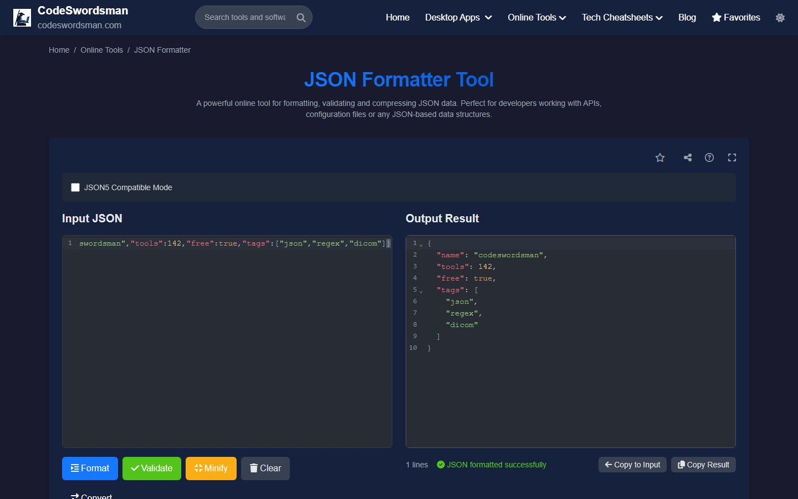
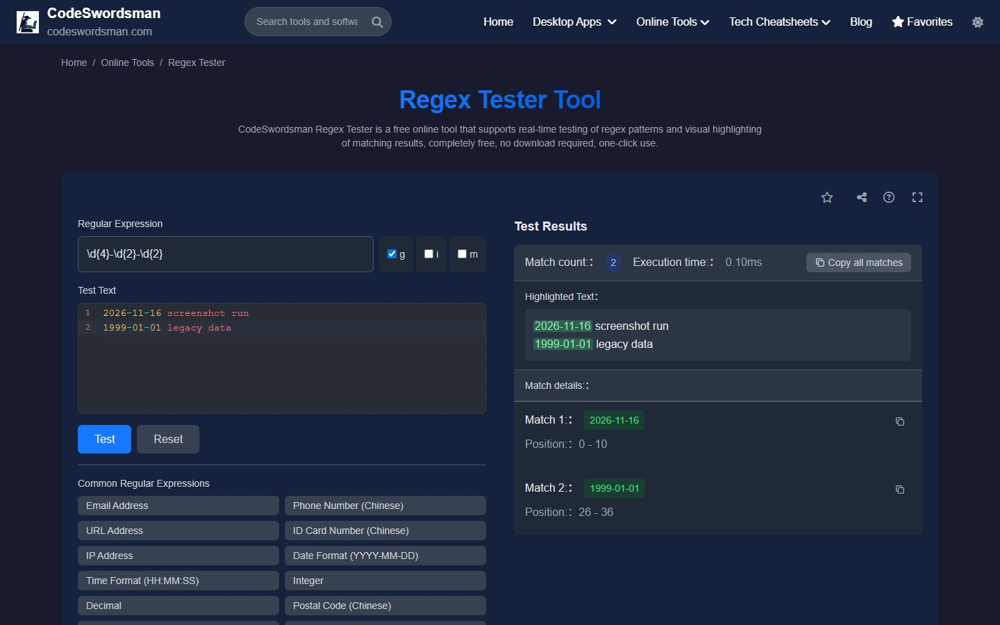
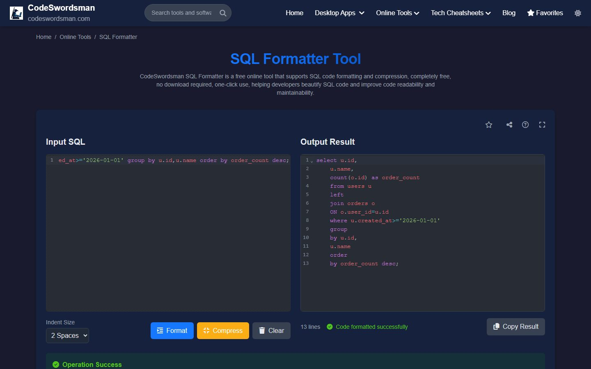
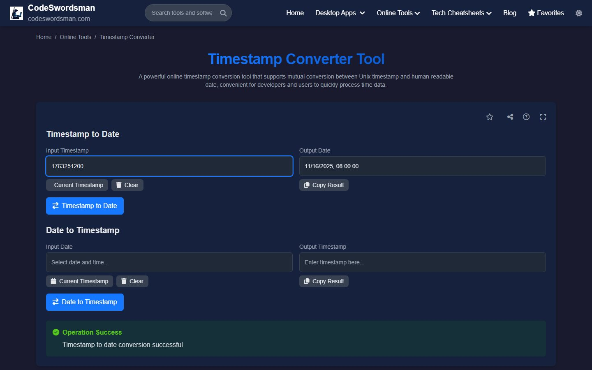
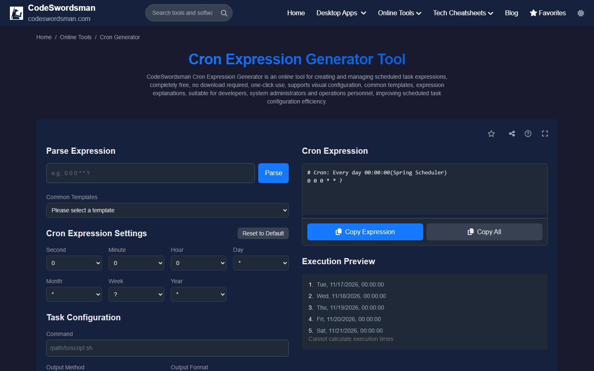
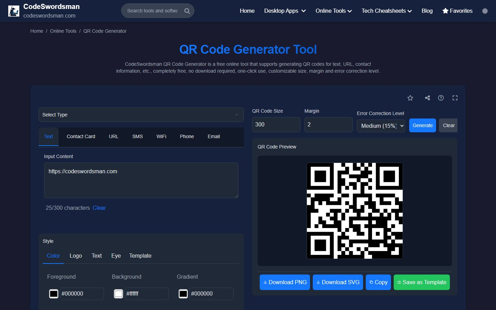
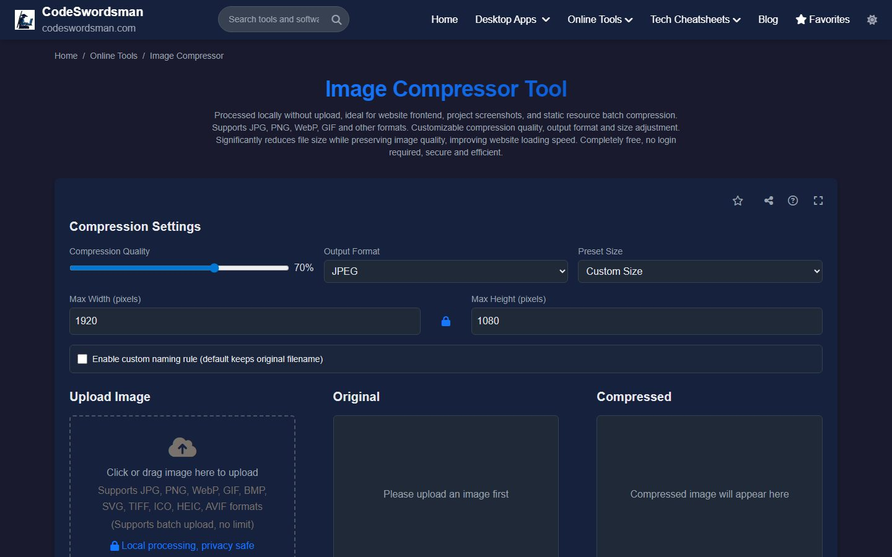
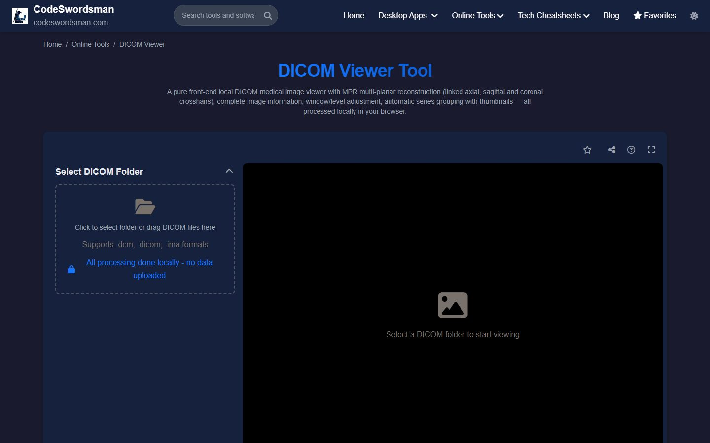

# CodeSwordsman · 142 Free Online Tools for Developers — JSON, Regex, SQL, Images, DICOM

A free online toolbox for developers, sysadmins and designers. Open a page and use it: no sign-up, no ads, and every file or text you paste is processed inside your own browser instead of being uploaded to a server.

> Start here: <https://codeswordsman.com/en-US/tools/>

This repository is the English tool directory for CodeSwordsman. It lists all 142 online tools by category so you can find the right one quickly. Only documentation and screenshots live here; the tools themselves are published on the website.

## Quick Links

| Entry | Address |
| --- | --- |
| All online tools | <https://codeswordsman.com/en-US/tools/> |
| JSON & data format tools | [docs/data.md](docs/data.md) |
| Encoding & security tools | [docs/security.md](docs/security.md) |
| Images & visual design tools | [docs/visual.md](docs/visual.md) |
| Medical imaging (DICOM) tools | [docs/medical.md](docs/medical.md) |

## Why CodeSwordsman

- **Free and no sign-up**: no account, no subscription, no usage limits.
- **No ads**: tool pages stay clean, with no banners or pop-ups.
- **Your data stays in the browser**: formatting, hashing, image compression and DICOM processing run locally; files and text are not uploaded.
- **Works everywhere**: desktop browsers, tablets and phones. Desktop utilities such as image converter, bulk renamer and site checker are also available.

## Popular Tools

### JSON Formatter

Paste messy JSON and get an indented, readable result in one click. Supports JSON5 validation, minify/beautify switching, and conversion to XML, YAML or CSV — handy when debugging API responses.

Try it: <https://codeswordsman.com/en-US/tools/json-formatter>

### Regex Tester

Test regular expressions with live match highlighting, flags and common patterns. Check your pattern against sample input without writing a throwaway script.

Try it: <https://codeswordsman.com/en-US/tools/regex-tester>

### SQL Formatter

Turn a single-line SQL statement into clean, indented SQL, or compress it back. Works with multiple database dialects and lets you keep your preferred keyword casing.

Try it: <https://codeswordsman.com/en-US/tools/sql-formatter>

### Timestamp Converter

Convert Unix timestamps to human-readable dates and back, with second/millisecond support and multiple formats — quick when you are reading logs.

Try it: <https://codeswordsman.com/en-US/tools/timestamp-converter>

### Cron Generator

Build cron expressions visually, preview upcoming run times, and copy the expression into your scheduler.

Try it: <https://codeswordsman.com/en-US/tools/cron-generator>

### QR Code Generator

Generate QR codes for URLs, contact cards, Wi-Fi credentials and more, with custom colors, styles and a center logo.

Try it: <https://codeswordsman.com/en-US/tools/qrcode-generator>

### Image Compressor

Compress images locally in batches and compare file sizes before downloading. Useful for site assets, documentation screenshots and repository images.

Try it: <https://codeswordsman.com/en-US/tools/image-compressor>

### DICOM Viewer

A pure front-end viewer for medical imaging: MPR reconstruction, window width/level adjustment and automatic series grouping. Image files never leave your device.

Try it: <https://codeswordsman.com/en-US/tools/dicom-viewer>

## Tool Directory

| Category | Tools | Highlights | Details |
| --- | --- | --- | --- |
| JSON & Data Formats | 21 | JSON Formatter, JSON Compare, JSON to Entity | [View](docs/data.md) |
| Code & Formatting | 10 | Code Formatter, SQL Formatter, JS Obfuscator | [View](docs/code.md) |
| Text & Content | 19 | Regex Tester, Text Diff, Character Counter | [View](docs/text.md) |
| Encoding & Security | 14 | MD5 Hash, JWT Decoder, SM Crypto | [View](docs/security.md) |
| Network & API | 12 | HTTP API Debugger, cURL to Code Converter, WebSocket Tester | [View](docs/network.md) |
| Images & Visual Design | 22 | Image Compressor, QR Code Generator, Color Converter | [View](docs/visual.md) |
| Site & SEO | 19 | TDK Checker, Sitemap Generator, Robots.txt Generator | [View](docs/site.md) |
| Dev & Ops | 7 | Nginx Visual Config Generator, Docker/Compose Generator, Kubernetes YAML Generator | [View](docs/devops.md) |
| Files & Documents | 6 | Excel to JSON/CSV, PDF Toolkit, ZIP Compress & Extract | [View](docs/file.md) |
| Time & Conversion | 5 | Timestamp Converter, Cron Generator, Timezone Converter | [View](docs/time.md) |
| Medical Imaging | 7 | DICOM Viewer, DICOM Anonymizer, DICOM Tag Viewer | [View](docs/medical.md) |

## All Tools

<!-- AUTO:ALL_TOOLS_START -->
### JSON & Data Formats (21)

| Tool | What it does | Open |
| --- | --- | --- |
| JSON Formatter | Online JSON formatting and validation tool, convenient for viewing and debugging JSON data | [Open](https://codeswordsman.com/en-US/tools/json-formatter) |
| JSON Data Toolkit | Batch field extraction, array splitting, key-value type casting | [Open](https://codeswordsman.com/en-US/tools/json-toolkit) |
| JSON Flatten & Unflatten | Convert nested JSON to flat path-keyed JSON and back | [Open](https://codeswordsman.com/en-US/tools/json-flatten) |
| JSON Compare | Compare the field differences between two JSON documents | [Open](https://codeswordsman.com/en-US/tools/json-compare) |
| JSONPath Tester | Query JSON with JSONPath expressions, including filters, recursive descent | [Open](https://codeswordsman.com/en-US/tools/jsonpath-tester) |
| JSON Schema Validator | Validate JSON against a JSON Schema with path-level errors | [Open](https://codeswordsman.com/en-US/tools/json-schema-validator) |
| JSON to Entity | Convert JSON data to entity class code | [Open](https://codeswordsman.com/en-US/tools/json-to-entity) |
| JSON to PHP Array | Convert JSON into a PHP array literal in one click, with array() or short [] syntax | [Open](https://codeswordsman.com/en-US/tools/json-to-php-array) |
| SQL to Go Struct | Free online SQL to Go Struct converter tool that automatically generates Go structs from… | [Open](https://codeswordsman.com/en-US/tools/sql-to-go-struct) |
| SQL DDL to PHP Array | Parse CREATE TABLE statements to extract column names, types, lengths | [Open](https://codeswordsman.com/en-US/tools/sql-ddl-to-php-array) |
| SQL DDL to Entity | Turn CREATE TABLE statements into TypeScript interfaces, Java entities or C# classes | [Open](https://codeswordsman.com/en-US/tools/sql-ddl-to-entity) |
| SQL Result Converter & Diff | Convert SQL query results, CSV, TSV or INSERT statements into Markdown tables, CSV | [Open](https://codeswordsman.com/en-US/tools/sql-result-converter) |
| JSON ↔ SQL INSERT Converter | Turn JSON arrays into escaped INSERT statements, or parse INSERT statements back into JSON | [Open](https://codeswordsman.com/en-US/tools/json-sql-converter) |
| CSV/JSON Converter | Convert between CSV and JSON formats for convenient data processing | [Open](https://codeswordsman.com/en-US/tools/csv-json-converter) |
| XML to JSON Converter | Convert XML to JSON and back with configurable attribute prefix, text key | [Open](https://codeswordsman.com/en-US/tools/xml-json-converter) |
| TOML / JSON / YAML Converter | Convert between TOML, JSON and YAML config formats with position-aware parse errors | [Open](https://codeswordsman.com/en-US/tools/toml-converter) |
| .env Parser & Converter | Parse a .env file and convert it to JSON, YAML, properties, shell export or Docker env | [Open](https://codeswordsman.com/en-US/tools/env-parser) |
| Test Data Generator | Build structured test data from field rules and export it as JSON, CSV or SQL INSERT | [Open](https://codeswordsman.com/en-US/tools/mock-data-generator) |
| UUID/Password Generator | Generate unique identifiers suitable for database primary keys and other scenarios | [Open](https://codeswordsman.com/en-US/tools/uuid-generator) |
| Random String Generator | Generate random strings of specified length and character set | [Open](https://codeswordsman.com/en-US/tools/random-string-generator) |
| Snowflake ID Generator & Decoder | Generate and decode Snowflake IDs with custom epoch, worker id and sequence — all local | [Open](https://codeswordsman.com/en-US/tools/snowflake-id) |

### Code & Formatting (10)

| Tool | What it does | Open |
| --- | --- | --- |
| Code Formatter | Supports code formatting for multiple programming languages, improving code readability | [Open](https://codeswordsman.com/en-US/tools/code-formatter) |
| SQL Formatter | Online SQL statement formatting tool to improve code readability | [Open](https://codeswordsman.com/en-US/tools/sql-formatter) |
| GraphQL & Protobuf Formatter | Format GraphQL SDL and Protobuf definitions online with consistent indentation | [Open](https://codeswordsman.com/en-US/tools/schema-formatter) |
| INI/YAML Formatter | Online INI and YAML file formatting tool | [Open](https://codeswordsman.com/en-US/tools/ini-yaml-formatter) |
| JS/CSS Minifier | Minify JavaScript and CSS online with optional console removal and variable mangling | [Open](https://codeswordsman.com/en-US/tools/code-minifier) |
| SCSS to CSS Compiler | Compile SCSS to CSS online with nested, expanded and compressed output styles | [Open](https://codeswordsman.com/en-US/tools/scss-compiler) |
| JS Obfuscator | Obfuscate JavaScript online with light, medium and strong presets covering string arrays | [Open](https://codeswordsman.com/en-US/tools/js-obfuscator) |
| SVG Optimizer | Remove comments | [Open](https://codeswordsman.com/en-US/tools/svg-optimizer) |
| Online Sandbox Editor | A browser-only online sandbox for HTML, CSS and JavaScript with split-pane editing | [Open](https://codeswordsman.com/en-US/tools/sandbox-editor) |
| Code to Image | Render code snippets as crisp images with highlighting, themes | [Open](https://codeswordsman.com/en-US/tools/code-to-image) |

### Text & Content (19)

| Tool | What it does | Open |
| --- | --- | --- |
| Text Diff | Compare differences between two texts, highlighting different parts | [Open](https://codeswordsman.com/en-US/tools/text-diff) |
| Character Counter | CodeSwordsman Character Counter is an online tool that supports counting characters, words | [Open](https://codeswordsman.com/en-US/tools/character-counter) |
| Text Processor | A powerful online text processing tool that provides various text processing functions | [Open](https://codeswordsman.com/en-US/tools/text-processor) |
| Text Tools | A powerful online text tool that provides various text processing functions | [Open](https://codeswordsman.com/en-US/tools/text-tools) |
| HTML Entities Converter | Convert special characters to HTML entities to ensure normal webpage display | [Open](https://codeswordsman.com/en-US/tools/html-entities-converter) |
| Unicode Chinese Converter | Convert Chinese text to Unicode escapes and back | [Open](https://codeswordsman.com/en-US/tools/unicode-converter) |
| Full-width Converter | Convert between half-width and full-width characters, covering letters, digits | [Open](https://codeswordsman.com/en-US/tools/fullwidth-converter) |
| Chinese Converter | Convert between Simplified and Traditional Chinese | [Open](https://codeswordsman.com/en-US/tools/zh-converter) |
| Chinese to Pinyin | Convert Chinese text to pinyin with tone marks, without tones, or as initials | [Open](https://codeswordsman.com/en-US/tools/pinyin-converter) |
| HTML Text Encoding Toolkit | Convert HTML to a JavaScript string, strip HTML tags | [Open](https://codeswordsman.com/en-US/tools/text-encoding-toolkit) |
| HTML to Markdown Converter | Convert HTML to Markdown with headings, lists, tables, code blocks | [Open](https://codeswordsman.com/en-US/tools/html-to-markdown) |
| Variable Naming Converter | Convert between different naming conventions, such as camel case, snake case, etc | [Open](https://codeswordsman.com/en-US/tools/variable-naming-converter) |
| Regex Tester | Online regex testing tool to verify matching results | [Open](https://codeswordsman.com/en-US/tools/regex-tester) |
| Regex Code Generator | Test a regular expression with live match highlighting | [Open](https://codeswordsman.com/en-US/tools/regex-code-generator) |
| Morse Code & Fun Encoders | Encode and decode Morse code with audio playback, apply Caesar shifts | [Open](https://codeswordsman.com/en-US/tools/text-codec-fun) |
| Text to Speech | Read text aloud with the browser's built-in speech engine and adjust voice, rate | [Open](https://codeswordsman.com/en-US/tools/text-to-speech) |
| AI Prompt Generator | CodeSwordsman AI Prompt Generator is a powerful online tool designed for developers | [Open](https://codeswordsman.com/en-US/tools/ai-prompt-generator) |
| Token Counter | Count tokens with the encodings used by popular LLMs and estimate request cost from public… | [Open](https://codeswordsman.com/en-US/tools/token-counter) |
| PRD & User Story Generator | Generate structured PRDs with feature lists and Given-When-Then acceptance criteria | [Open](https://codeswordsman.com/en-US/tools/prd-generator) |

### Encoding & Security (14)

| Tool | What it does | Open |
| --- | --- | --- |
| URL/Base64 Converter | Online URL and Base64 conversion tool for convenient data transmission | [Open](https://codeswordsman.com/en-US/tools/url-base64-encoder) |
| Online Base64 Image Converter | Online Base64 Image Converter, supports bidirectional conversion between images and Base64 | [Open](https://codeswordsman.com/en-US/tools/base64-image-converter) |
| Base Converter | Convert between binary, decimal, hexadecimal and other different bases | [Open](https://codeswordsman.com/en-US/tools/base-converter) |
| MD5 Hash | Free online MD5 hash calculator supporting text and file MD5 computation with 16/32-bit… | [Open](https://codeswordsman.com/en-US/tools/md5-encryption) |
| Hash and HMAC Toolkit | Compute MD5, SHA-1, SHA-256, SHA-384 and SHA-512 hashes for text or files | [Open](https://codeswordsman.com/en-US/tools/hash-toolkit) |
| AES Encryption Tool | Encrypt and decrypt with AES, DES and 3DES in CBC, GCM, CTR and ECB modes | [Open](https://codeswordsman.com/en-US/tools/aes-encryption) |
| RSA Toolkit | Generate RSA key pairs, encrypt with the public key, decrypt and sign, with PEM import | [Open](https://codeswordsman.com/en-US/tools/rsa-toolkit) |
| SM Crypto | SM crypto online tool supporting SM2 asymmetric encryption/decryption with… | [Open](https://codeswordsman.com/en-US/tools/sm-crypto) |
| JWT Decoder | Decode JWT header and payload, inspect claims and expiry | [Open](https://codeswordsman.com/en-US/tools/jwt-decoder) |
| JWT Generator & Verifier | Sign JWTs locally in your browser with HS256/HS384/HS512, customize the header and payload | [Open](https://codeswordsman.com/en-US/tools/jwt-generator) |
| Password Strength Checker | Evaluate password strength, entropy and crack time locally | [Open](https://codeswordsman.com/en-US/tools/password-strength) |
| bcrypt & Argon2 Verifier | Generate bcrypt, Argon2id and scrypt password hashes locally in your browser | [Open](https://codeswordsman.com/en-US/tools/password-hash-verifier) |
| Security Headers Generator | Configure Content-Security-Policy and common security headers visually | [Open](https://codeswordsman.com/en-US/tools/security-headers-generator) |
| Browser Fingerprint Check | Collect Canvas, WebGL, AudioContext, fonts, timezone | [Open](https://codeswordsman.com/en-US/tools/browser-fingerprint) |

### Network & API (12)

| Tool | What it does | Open |
| --- | --- | --- |
| HTTP API Debugger | CodeSwordsman HTTP API Debugger is a completely free | [Open](https://codeswordsman.com/en-US/tools/http-debugger) |
| WebSocket Tester | CodeSwordsman WebSocket Tester is a powerful online WebSocket debugger that supports… | [Open](https://codeswordsman.com/en-US/tools/websocket-tester) |
| cURL to Code Converter | Convert cURL commands into Python, JavaScript, Node.js, Go, PHP or Java request code | [Open](https://codeswordsman.com/en-US/tools/curl-converter) |
| URL Parser | Online URL parsing tool to analyze URL components | [Open](https://codeswordsman.com/en-US/tools/url-parser) |
| User-Agent Toolkit | Parse User-Agent strings into browser, engine, OS, device and CPU details | [Open](https://codeswordsman.com/en-US/tools/user-agent-toolkit) |
| Cookie Converter | Convert Cookie strings to JSON and back while preserving Path, Domain, Expires | [Open](https://codeswordsman.com/en-US/tools/cookie-converter) |
| HTTP Status & Port Reference | Searchable reference for HTTP status codes | [Open](https://codeswordsman.com/en-US/tools/http-reference) |
| IP Location Lookup | Look up IP or domain locations with IPv4/IPv6, country, region, city and ISP | [Open](https://codeswordsman.com/en-US/tools/ip-location-lookup) |
| IP Address Toolkit | Free online IP address toolkit with subnet mask calculation, CIDR calculation, subnetting | [Open](https://codeswordsman.com/en-US/tools/ip-address-toolkit) |
| IP Address Generator | Generate random IPv4 and IPv6 addresses in batch with optional prefixes and compressed… | [Open](https://codeswordsman.com/en-US/tools/ip-address-generator) |
| MAC Address Generator | Generate random MAC addresses with optional vendor OUI prefix | [Open](https://codeswordsman.com/en-US/tools/mac-address-generator) |
| HTTP Header & Auth Toolkit | Convert Request/Response header strings into JSON with duplicate keys merged into arrays | [Open](https://codeswordsman.com/en-US/tools/network-toolkit) |

### Images & Visual Design (22)

| Tool | What it does | Open |
| --- | --- | --- |
| Image Compressor | ideal for website frontend, project screenshots, static resource batch compression | [Open](https://codeswordsman.com/en-US/tools/image-compressor) |
| Image Format Converter | Batch convert PNG, JPEG, WebP, AVIF and ICO with HEIC input | [Open](https://codeswordsman.com/en-US/tools/image-format-converter) |
| Image Cropper | Drag to crop, lock aspect ratios, rotate and flip | [Open](https://codeswordsman.com/en-US/tools/image-cropper) |
| Image Watermark | Add text watermarks with custom size, color, opacity, rotation and tiling | [Open](https://codeswordsman.com/en-US/tools/image-watermark) |
| Image Splitter & Stitcher | Split an image into a 3×3 grid or custom rows and columns | [Open](https://codeswordsman.com/en-US/tools/image-splitter) |
| Image OCR | Extract text from images locally in your browser, with Chinese | [Open](https://codeswordsman.com/en-US/tools/image-ocr) |
| EXIF Viewer & Remover | Inspect camera, lens, capture time and GPS data | [Open](https://codeswordsman.com/en-US/tools/exif-viewer) |
| Image Metadata Remover | Remove EXIF, GPS location and text comments from JPEG | [Open](https://codeswordsman.com/en-US/tools/exif-remover) |
| QR Code Generator | Convert text or URL to QR code for easy scanning access | [Open](https://codeswordsman.com/en-US/tools/qrcode-generator) |
| Bulk QR Generator | Paste one item per line to generate up to 50 QR codes at once and download them as a ZIP | [Open](https://codeswordsman.com/en-US/tools/qrcode-styler) |
| QR Code Reader | Online QR code recognition tool to extract QR code information from images | [Open](https://codeswordsman.com/en-US/tools/qrcode-reader) |
| Barcode Generator | Generate CODE128, CODE39, EAN-13 and UPC barcodes, export PNG or SVG | [Open](https://codeswordsman.com/en-US/tools/barcode-generator) |
| Font Converter | Convert TTF, OTF, WOFF and WOFF2 online, subset fonts to keep chosen characters | [Open](https://codeswordsman.com/en-US/tools/font-converter) |
| Favicon Generator | Upload one image to generate favicons from 16 to 512 px, a multi-size favicon.ico | [Open](https://codeswordsman.com/en-US/tools/favicon-generator) |
| Social Image Resizer | Upload one key visual and export every social size at once with crop or fit modes | [Open](https://codeswordsman.com/en-US/tools/social-image-resizer) |
| Word Cloud Generator | Turn reviews or survey text into a word cloud with adjustable shape, palette and rotation | [Open](https://codeswordsman.com/en-US/tools/word-cloud-generator) |
| CSS Visual Generator | Visually build CSS gradients, shadows | [Open](https://codeswordsman.com/en-US/tools/css-visual-generator) |
| Flex/Grid Layout Generator | Tune Flex and Grid properties visually | [Open](https://codeswordsman.com/en-US/tools/css-layout-generator) |
| clip-path Shape Generator | Generate CSS clip-path shapes online | [Open](https://codeswordsman.com/en-US/tools/clip-path-generator) |
| CSS Unit Converter | Convert between px, rem, em, percent, vw | [Open](https://codeswordsman.com/en-US/tools/css-unit-converter) |
| Color Converter | Convert between different color formats, such as RGB, HEX, HSL, etc | [Open](https://codeswordsman.com/en-US/tools/color-converter) |
| Mermaid Diagram Editor | Draw flowcharts, sequence and ER diagrams, Gantt charts with plain text | [Open](https://codeswordsman.com/en-US/tools/mermaid-renderer) |

### Site & SEO (19)

| Tool | What it does | Open |
| --- | --- | --- |
| Meta Tag Generator | Fill in title, description | [Open](https://codeswordsman.com/en-US/tools/meta-tag-generator) |
| Robots.txt Generator | Generate robots.txt with User-agent, Allow, Disallow, Crawl-delay and Sitemap rules | [Open](https://codeswordsman.com/en-US/tools/robots-txt-generator) |
| Sitemap Generator | Generate sitemap.xml from a list of paths with lastmod, changefreq | [Open](https://codeswordsman.com/en-US/tools/sitemap-generator) |
| JSON-LD Structured Data Generator | Generate schema.org JSON-LD for articles, products, FAQs, breadcrumbs and more | [Open](https://codeswordsman.com/en-US/tools/json-ld-generator) |
| Web Assets Toolkit | Convert SVG to Data-URI | [Open](https://codeswordsman.com/en-US/tools/web-assets-toolkit) |
| TDK Checker | Fetch TDK, H1 and OG/Twitter metadata with missing and length checks | [Open](https://codeswordsman.com/en-US/tools/tdk-checker) |
| Sitemap & Link Extractor | Fetch sitemaps or extract page links, including indexes and gzip, copy or download | [Open](https://codeswordsman.com/en-US/tools/sitemap-extractor) |
| Broken Link Checker | Check up to 50 URLs at once with automatic GET fallback, grouped by healthy | [Open](https://codeswordsman.com/en-US/tools/broken-link-checker) |
| Redirect Chain Checker | Inspect short link redirects hop by hop with status codes and timings, detect loops | [Open](https://codeswordsman.com/en-US/tools/redirect-chain-checker) |
| HTTP Headers Checker | Check status code, redirect chain, gzip/brotli, HSTS and CDN details | [Open](https://codeswordsman.com/en-US/tools/http-headers-checker) |
| SSL Certificate Checker | Check a domain's SSL certificate in real time: issuer, validity | [Open](https://codeswordsman.com/en-US/tools/ssl-checker) |
| SSL Certificate Parser | Inspect subject, issuer, validity, SAN domains and SHA-256 fingerprint, including chains | [Open](https://codeswordsman.com/en-US/tools/ssl-cert-parser) |
| DNS Lookup | Query A, AAAA, CNAME, MX, TXT, NS and SOA records with values and TTLs | [Open](https://codeswordsman.com/en-US/tools/dns-lookup) |
| RDAP Domain Lookup | Look up registrar, registration and expiry dates, nameservers and status via RDAP | [Open](https://codeswordsman.com/en-US/tools/rdap-lookup) |
| Email Auth Checker | Check SPF, DMARC and DKIM records to review email sending security | [Open](https://codeswordsman.com/en-US/tools/email-auth-checker) |
| UTM Link Builder | Build campaign links with UTM parameters, channel presets, batch generation and QR codes | [Open](https://codeswordsman.com/en-US/tools/utm-link-builder) |
| Social Share Card Preview | Preview how a page looks on Twitter, WeChat, Feishu and LinkedIn, with title | [Open](https://codeswordsman.com/en-US/tools/social-card-preview) |
| Competitor Feature Matrix | Compare competitors feature by feature with weights, three-state ratings | [Open](https://codeswordsman.com/en-US/tools/competitor-matrix) |
| Marketing Calendar | Holidays, e-commerce sales and global events with countdowns and lead times | [Open](https://codeswordsman.com/en-US/tools/marketing-calendar) |

### Dev & Ops (7)

| Tool | What it does | Open |
| --- | --- | --- |
| Docker/Compose Generator | CodeSwordsman Docker/Compose Generator is a powerful online tool for generating and… | [Open](https://codeswordsman.com/en-US/tools/docker-compose-generator) |
| Dockerfile Generator | Generate Dockerfile and .dockerignore by stack, with multi-stage builds | [Open](https://codeswordsman.com/en-US/tools/dockerfile-generator) |
| Kubernetes YAML Generator | Generate Deployment, Service | [Open](https://codeswordsman.com/en-US/tools/kubernetes-yaml-generator) |
| Nginx Visual Config Generator | CodeSwordsman Nginx Visual Config Generator is a powerful online visual tool supporting… | [Open](https://codeswordsman.com/en-US/tools/nginx-config-generator) |
| systemd Unit Generator | Generate systemd service, timer and socket units with deployment and log commands | [Open](https://codeswordsman.com/en-US/tools/systemd-generator) |
| Linux Firewall Rule Visual Generator | One-stop visual generation of iptables, UFW, nftables firewall rules | [Open](https://codeswordsman.com/en-US/tools/iptables-generator) |
| .gitignore Generator | Build a .gitignore from language, framework | [Open](https://codeswordsman.com/en-US/tools/gitignore-generator) |

### Files & Documents (6)

| Tool | What it does | Open |
| --- | --- | --- |
| ZIP Compress & Extract | Bundle files into a ZIP or inspect a ZIP and download entries individually | [Open](https://codeswordsman.com/en-US/tools/zip-tool) |
| Excel to JSON/CSV | Read xlsx, xls and csv by sheet and export JSON or CSV, or build Excel from JSON | [Open](https://codeswordsman.com/en-US/tools/excel-converter) |
| PDF Toolkit | Merge PDFs, extract page ranges | [Open](https://codeswordsman.com/en-US/tools/pdf-toolkit) |
| Markdown Exporter | Paste or upload Markdown, preview it live and export to HTML, PDF or plain text | [Open](https://codeswordsman.com/en-US/tools/markdown-exporter) |
| Markdown Editor | Online Markdown editor with real-time preview of editing effects | [Open](https://codeswordsman.com/en-US/tools/markdown-editor) |
| Rich Text Editor Suite | Preview CKEditor 5, CKEditor 4 and TinyMCE rich text editors online | [Open](https://codeswordsman.com/en-US/tools/rich-text-editor-suite) |

### Time & Conversion (5)

| Tool | What it does | Open |
| --- | --- | --- |
| Timestamp Converter | Convert between Unix timestamp and human-readable time | [Open](https://codeswordsman.com/en-US/tools/timestamp-converter) |
| Timezone Converter | Compare times across cities | [Open](https://codeswordsman.com/en-US/tools/timezone-converter) |
| Date Calculator | Day and workday differences, date arithmetic, age and next birthday — computed locally | [Open](https://codeswordsman.com/en-US/tools/date-calculator) |
| Cron Generator | Online Cron expression generation tool for scheduled task configuration | [Open](https://codeswordsman.com/en-US/tools/cron-generator) |
| Unit Converter | Convert length, weight, temperature, area, volume, time, speed, storage | [Open](https://codeswordsman.com/en-US/tools/unit-converter) |

### Medical Imaging (7)

| Tool | What it does | Open |
| --- | --- | --- |
| DICOM Viewer | Pure front-end local DICOM viewer with MPR multi-planar reconstruction, image information | [Open](https://codeswordsman.com/en-US/tools/dicom-viewer) |
| DICOM Anonymizer | Pure front-end local DICOM anonymizer with privacy tag selection | [Open](https://codeswordsman.com/en-US/tools/dicom-anonymizer) |
| DICOM Detector | Pure front-end local DICOM detector that samples DICOM header metadata to quickly identify… | [Open](https://codeswordsman.com/en-US/tools/dicom-type-detector) |
| DICOM to Image Converter | Pure front-end local DICOM to image converter: drop a folder or ZIP archive to batch… | [Open](https://codeswordsman.com/en-US/tools/dicom-to-image) |
| DICOM Tag Viewer | Pure front-end local DICOM tag viewer: browse all metadata tags of a DICOM file in a tree… | [Open](https://codeswordsman.com/en-US/tools/dicom-tag-viewer) |
| DICOM Series Validator | Pure front-end local DICOM series validator: batch import folders and read only DICOM… | [Open](https://codeswordsman.com/en-US/tools/dicom-series-validator) |
| DICOM Metadata Editor | A fully client-side DICOM metadata editor: drop a folder to import files grouped… | [Open](https://codeswordsman.com/en-US/tools/dicom-metadata-editor) |
<!-- AUTO:ALL_TOOLS_END -->

## How to Use

1. Open a tool from the list above or from the [all tools](https://codeswordsman.com/en-US/tools/) page.
2. Paste text, fill in parameters, or upload a file.
3. Read the result on the page and copy or download it. Processing happens locally in your browser.

## FAQ

**Are these online tools free?**
Yes. Every tool is free to use, with no account, subscription or payment required.

**Do I need to create an account?**
No. Open the page and start using the tool; there are no usage limits.

**Are my files or pasted text uploaded to a server?**
Formatting, hashing, encryption, image processing and DICOM tools run in the browser, so content is not uploaded. A few lookup tools rely on third-party APIs and say so on the page.

**Can I use the tools offline?**
You need a connection to open the pages. Once loaded, most local-processing tools keep working even if the connection drops.

**Which browsers are supported?**
Current versions of Chrome, Edge, Firefox and Safari, including their mobile versions.

**Are there desktop apps too?**
Yes. The image converter, bulk renamer and site checker are published on the Microsoft Store; see the software section of the website.

## Privacy & Data Security

Tools prefer local computation in your browser, so files and text stay on your device. No account information is required and tool input is not collected. See the [privacy policy](https://codeswordsman.com/en-US/legal/privacy-policy) for details.

## Feedback

- Questions and feature requests: <support@majk.cn>
- Website: <https://codeswordsman.com/en-US/>

## Copyright

Documentation and screenshots in this repository describe CodeSwordsman online tools and are copyrighted by CodeSwordsman. Linking to the tools is welcome; please credit the source and do not copy the whole site or its page copy.
