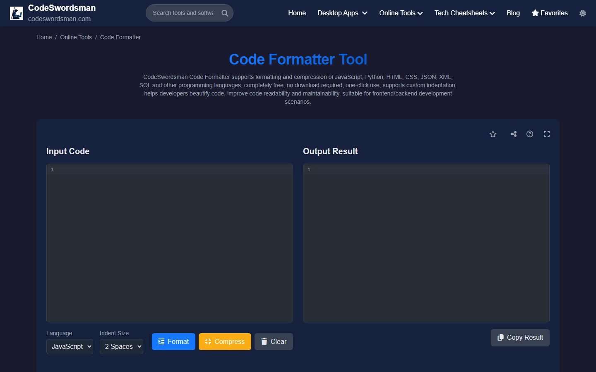

# Code & Formatting Tools (10)

Code utilities for everyday development: multi-language code formatting, minification, JavaScript obfuscation, SCSS compilation and an in-browser sandbox editor. Use them when a snippet arrives with broken indentation, when you need a compact build of a script, or when you want to try a small piece of HTML/CSS/JS without setting up a local toolchain.

<!-- AUTO:TOOLS_START -->
| Tool | What it does | Open |
| --- | --- | --- |
| Code Formatter | Supports code formatting for multiple programming languages, improving code readability | [Open](https://codeswordsman.com/en-US/tools/code-formatter) |
| SQL Formatter | Online SQL statement formatting tool to improve code readability | [Open](https://codeswordsman.com/en-US/tools/sql-formatter) |
| GraphQL & Protobuf Formatter | Format GraphQL SDL and Protobuf definitions online with consistent indentation | [Open](https://codeswordsman.com/en-US/tools/schema-formatter) |
| INI/YAML Formatter | Online INI and YAML file formatting tool | [Open](https://codeswordsman.com/en-US/tools/ini-yaml-formatter) |
| JS/CSS Minifier | Minify JavaScript and CSS online with optional console removal and variable mangling | [Open](https://codeswordsman.com/en-US/tools/code-minifier) |
| SCSS to CSS Compiler | Compile SCSS to CSS online with nested, expanded and compressed output styles | [Open](https://codeswordsman.com/en-US/tools/scss-compiler) |
| JS Obfuscator | Obfuscate JavaScript online with light, medium and strong presets covering string arrays | [Open](https://codeswordsman.com/en-US/tools/js-obfuscator) |
| SVG Optimizer | Remove comments | [Open](https://codeswordsman.com/en-US/tools/svg-optimizer) |
| Online Sandbox Editor | A browser-only online sandbox for HTML, CSS and JavaScript with split-pane editing | [Open](https://codeswordsman.com/en-US/tools/sandbox-editor) |
| Code to Image | Render code snippets as crisp images with highlighting, themes | [Open](https://codeswordsman.com/en-US/tools/code-to-image) |
<!-- AUTO:TOOLS_END -->

## Screenshot

## Related Categories

- [JSON & Data Format Tools](data.md): JSON, SQL and entity conversion
- [Text & Content Tools](text.md): regex testing and text diff
- [Encoding & Security Tools](security.md): hashing, JWT and encryption

Back to [all tools](../README.md)
