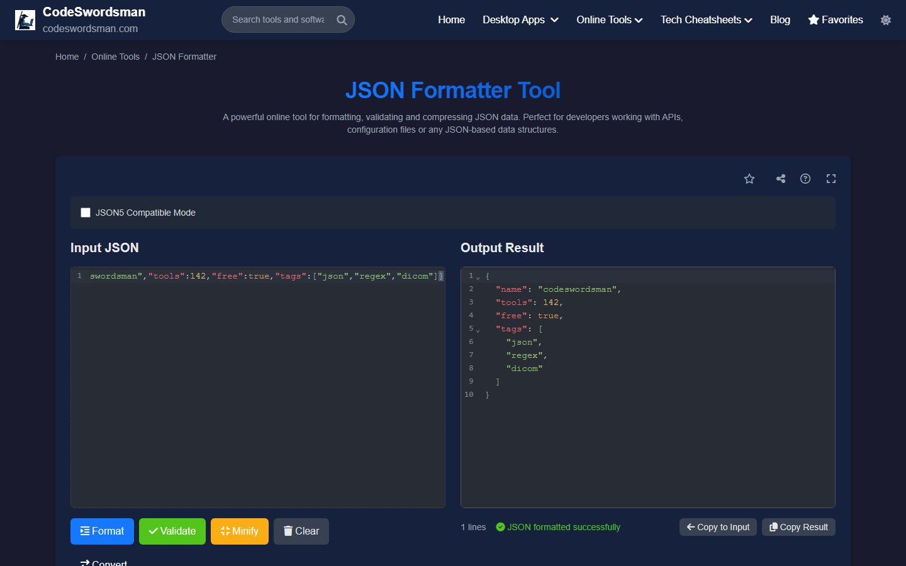

# JSON & Data Format Tools (21)

Format, validate, compare and convert JSON in the browser. Paste an API response to beautify or minify it, flatten nested objects, check it against a JSON Schema, or convert JSON to entity classes, PHP arrays, XML, YAML and CSV. There are also SQL and YAML helpers — DDL to Go struct, DDL to PHP array, JSON to SQL — plus generators for mock data and config files. Everything is processed locally, so your payloads never leave the page.

<!-- AUTO:TOOLS_START -->
| Tool | What it does | Open |
| --- | --- | --- |
| JSON Formatter | Online JSON formatting and validation tool, convenient for viewing and debugging JSON data | [Open](https://codeswordsman.com/en-US/tools/json-formatter) |
| JSON Data Toolkit | Batch field extraction, array splitting, key-value type casting | [Open](https://codeswordsman.com/en-US/tools/json-toolkit) |
| JSON Flatten & Unflatten | Convert nested JSON to flat path-keyed JSON and back | [Open](https://codeswordsman.com/en-US/tools/json-flatten) |
| JSON Compare | Compare the field differences between two JSON documents | [Open](https://codeswordsman.com/en-US/tools/json-compare) |
| JSONPath Tester | Query JSON with JSONPath expressions, including filters, recursive descent | [Open](https://codeswordsman.com/en-US/tools/jsonpath-tester) |
| JSON Schema Validator | Validate JSON against a JSON Schema with path-level errors | [Open](https://codeswordsman.com/en-US/tools/json-schema-validator) |
| JSON to Entity | Convert JSON data to entity class code | [Open](https://codeswordsman.com/en-US/tools/json-to-entity) |
| JSON to PHP Array | Convert JSON into a PHP array literal in one click, with array() or short [] syntax | [Open](https://codeswordsman.com/en-US/tools/json-to-php-array) |
| SQL to Go Struct | Free online SQL to Go Struct converter tool that automatically generates Go structs from… | [Open](https://codeswordsman.com/en-US/tools/sql-to-go-struct) |
| SQL DDL to PHP Array | Parse CREATE TABLE statements to extract column names, types, lengths | [Open](https://codeswordsman.com/en-US/tools/sql-ddl-to-php-array) |
| SQL DDL to Entity | Turn CREATE TABLE statements into TypeScript interfaces, Java entities or C# classes | [Open](https://codeswordsman.com/en-US/tools/sql-ddl-to-entity) |
| SQL Result Converter & Diff | Convert SQL query results, CSV, TSV or INSERT statements into Markdown tables, CSV | [Open](https://codeswordsman.com/en-US/tools/sql-result-converter) |
| JSON ↔ SQL INSERT Converter | Turn JSON arrays into escaped INSERT statements, or parse INSERT statements back into JSON | [Open](https://codeswordsman.com/en-US/tools/json-sql-converter) |
| CSV/JSON Converter | Convert between CSV and JSON formats for convenient data processing | [Open](https://codeswordsman.com/en-US/tools/csv-json-converter) |
| XML to JSON Converter | Convert XML to JSON and back with configurable attribute prefix, text key | [Open](https://codeswordsman.com/en-US/tools/xml-json-converter) |
| TOML / JSON / YAML Converter | Convert between TOML, JSON and YAML config formats with position-aware parse errors | [Open](https://codeswordsman.com/en-US/tools/toml-converter) |
| .env Parser & Converter | Parse a .env file and convert it to JSON, YAML, properties, shell export or Docker env | [Open](https://codeswordsman.com/en-US/tools/env-parser) |
| Test Data Generator | Build structured test data from field rules and export it as JSON, CSV or SQL INSERT | [Open](https://codeswordsman.com/en-US/tools/mock-data-generator) |
| UUID/Password Generator | Generate unique identifiers suitable for database primary keys and other scenarios | [Open](https://codeswordsman.com/en-US/tools/uuid-generator) |
| Random String Generator | Generate random strings of specified length and character set | [Open](https://codeswordsman.com/en-US/tools/random-string-generator) |
| Snowflake ID Generator & Decoder | Generate and decode Snowflake IDs with custom epoch, worker id and sequence — all local | [Open](https://codeswordsman.com/en-US/tools/snowflake-id) |
<!-- AUTO:TOOLS_END -->

## Screenshot

## Related Categories

- [Code & Formatting Tools](code.md): beautify, compress and obfuscate code
- [Text & Content Tools](text.md): diffs, counters and text processing
- [Dev & Ops Tools](devops.md): Docker, Kubernetes and Nginx config generators

Back to [all tools](../README.md)
