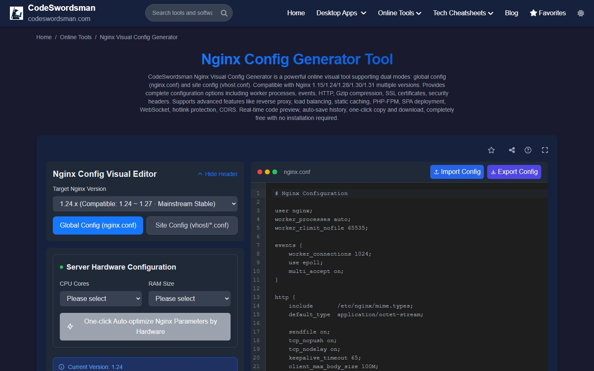

# Dev & Ops Tools (7)

Configuration generators for developers and operators: Nginx visual configuration with hardware-based tuning suggestions, Dockerfile generation, Docker Compose generation, Kubernetes YAML generation, systemd unit generation, iptables rule generation with visualization, and .gitignore template generation. Pick the options and copy a working config instead of hunting through docs and fixing indentation by hand.

<!-- AUTO:TOOLS_START -->
| Tool | What it does | Open |
| --- | --- | --- |
| Docker/Compose Generator | CodeSwordsman Docker/Compose Generator is a powerful online tool for generating and… | [Open](https://codeswordsman.com/en-US/tools/docker-compose-generator) |
| Dockerfile Generator | Generate Dockerfile and .dockerignore by stack, with multi-stage builds | [Open](https://codeswordsman.com/en-US/tools/dockerfile-generator) |
| Kubernetes YAML Generator | Generate Deployment, Service | [Open](https://codeswordsman.com/en-US/tools/kubernetes-yaml-generator) |
| Nginx Visual Config Generator | CodeSwordsman Nginx Visual Config Generator is a powerful online visual tool supporting… | [Open](https://codeswordsman.com/en-US/tools/nginx-config-generator) |
| systemd Unit Generator | Generate systemd service, timer and socket units with deployment and log commands | [Open](https://codeswordsman.com/en-US/tools/systemd-generator) |
| Linux Firewall Rule Visual Generator | One-stop visual generation of iptables, UFW, nftables firewall rules | [Open](https://codeswordsman.com/en-US/tools/iptables-generator) |
| .gitignore Generator | Build a .gitignore from language, framework | [Open](https://codeswordsman.com/en-US/tools/gitignore-generator) |
<!-- AUTO:TOOLS_END -->

## Screenshot

## Related Categories

- [Network & API Tools](network.md): ports, DNS and request troubleshooting
- [JSON & Data Format Tools](data.md): YAML and JSON conversion
- [Code & Formatting Tools](code.md): config and code formatting

Back to [all tools](../README.md)
