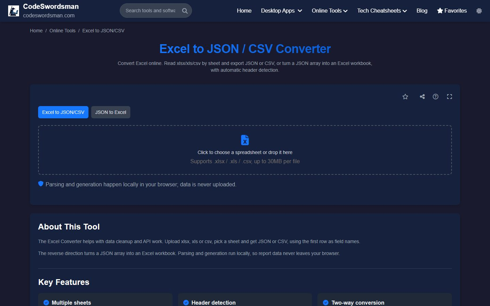

# Files & Documents Tools (6)

File conversion and packaging tools: Excel to JSON/CSV and back, PDF merge, split and page operations, ZIP compress and extract in the browser, Markdown export and a rich text editing suite. Files are parsed and generated locally, which keeps internal spreadsheets and documents off any server.

<!-- AUTO:TOOLS_START -->
| Tool | What it does | Open |
| --- | --- | --- |
| ZIP Compress & Extract | Bundle files into a ZIP or inspect a ZIP and download entries individually | [Open](https://codeswordsman.com/en-US/tools/zip-tool) |
| Excel to JSON/CSV | Read xlsx, xls and csv by sheet and export JSON or CSV, or build Excel from JSON | [Open](https://codeswordsman.com/en-US/tools/excel-converter) |
| PDF Toolkit | Merge PDFs, extract page ranges | [Open](https://codeswordsman.com/en-US/tools/pdf-toolkit) |
| Markdown Exporter | Paste or upload Markdown, preview it live and export to HTML, PDF or plain text | [Open](https://codeswordsman.com/en-US/tools/markdown-exporter) |
| Markdown Editor | Online Markdown editor with real-time preview of editing effects | [Open](https://codeswordsman.com/en-US/tools/markdown-editor) |
| Rich Text Editor Suite | Preview CKEditor 5, CKEditor 4 and TinyMCE rich text editors online | [Open](https://codeswordsman.com/en-US/tools/rich-text-editor-suite) |
<!-- AUTO:TOOLS_END -->

## Screenshot

## Related Categories

- [Text & Content Tools](text.md): Markdown editing and text diff
- [Images & Visual Design Tools](visual.md): image conversion and compression
- [JSON & Data Format Tools](data.md): CSV and JSON conversion

Back to [all tools](../README.md)
