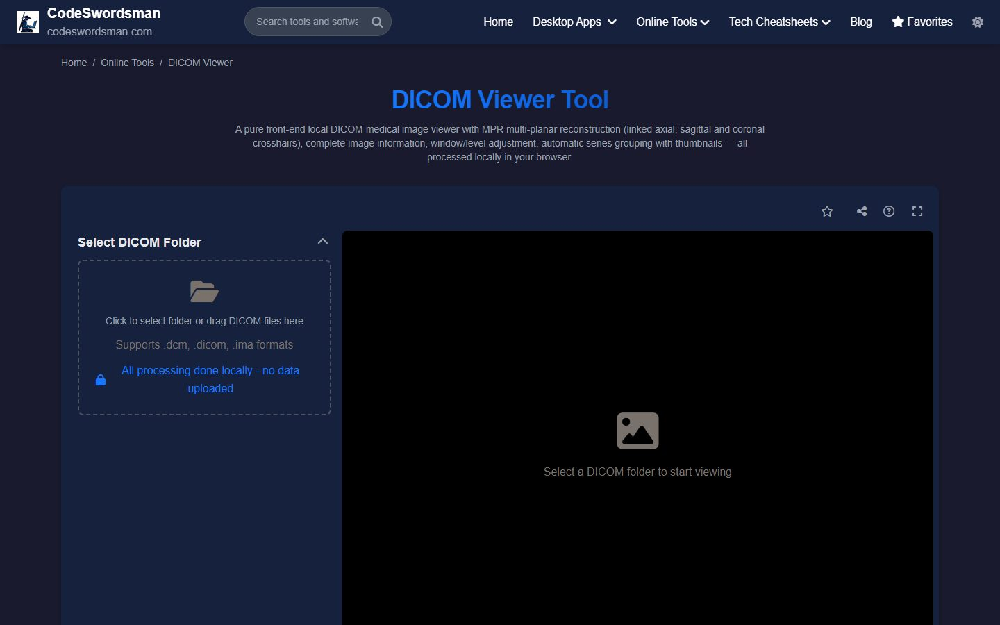

# Medical Imaging (DICOM) Tools (7)

A front-end DICOM toolkit that runs entirely in the browser: online viewing with MPR reconstruction, window width/level adjustment and automatic series grouping; anonymization with privacy tag selection, UID regeneration, private tag cleanup and per-study ZIP export; tag inspection, modality detection (CT/MR/DR/US), series validation, metadata editing and DICOM to image conversion. Image files are parsed locally and are not uploaded, which makes the tools suitable for pre-checks, de-identification and format conversion.

<!-- AUTO:TOOLS_START -->
| Tool | What it does | Open |
| --- | --- | --- |
| DICOM Viewer | Pure front-end local DICOM viewer with MPR multi-planar reconstruction, image information | [Open](https://codeswordsman.com/en-US/tools/dicom-viewer) |
| DICOM Anonymizer | Pure front-end local DICOM anonymizer with privacy tag selection | [Open](https://codeswordsman.com/en-US/tools/dicom-anonymizer) |
| DICOM Detector | Pure front-end local DICOM detector that samples DICOM header metadata to quickly identify… | [Open](https://codeswordsman.com/en-US/tools/dicom-type-detector) |
| DICOM to Image Converter | Pure front-end local DICOM to image converter: drop a folder or ZIP archive to batch… | [Open](https://codeswordsman.com/en-US/tools/dicom-to-image) |
| DICOM Tag Viewer | Pure front-end local DICOM tag viewer: browse all metadata tags of a DICOM file in a tree… | [Open](https://codeswordsman.com/en-US/tools/dicom-tag-viewer) |
| DICOM Series Validator | Pure front-end local DICOM series validator: batch import folders and read only DICOM… | [Open](https://codeswordsman.com/en-US/tools/dicom-series-validator) |
| DICOM Metadata Editor | A fully client-side DICOM metadata editor: drop a folder to import files grouped… | [Open](https://codeswordsman.com/en-US/tools/dicom-metadata-editor) |
<!-- AUTO:TOOLS_END -->

## Screenshot

## Related Categories

- [Images & Visual Design Tools](visual.md): compress and convert exported images
- [Files & Documents Tools](file.md): ZIP packaging and file handling
- [Encoding & Security Tools](security.md): privacy and de-identification

Back to [all tools](../README.md)
