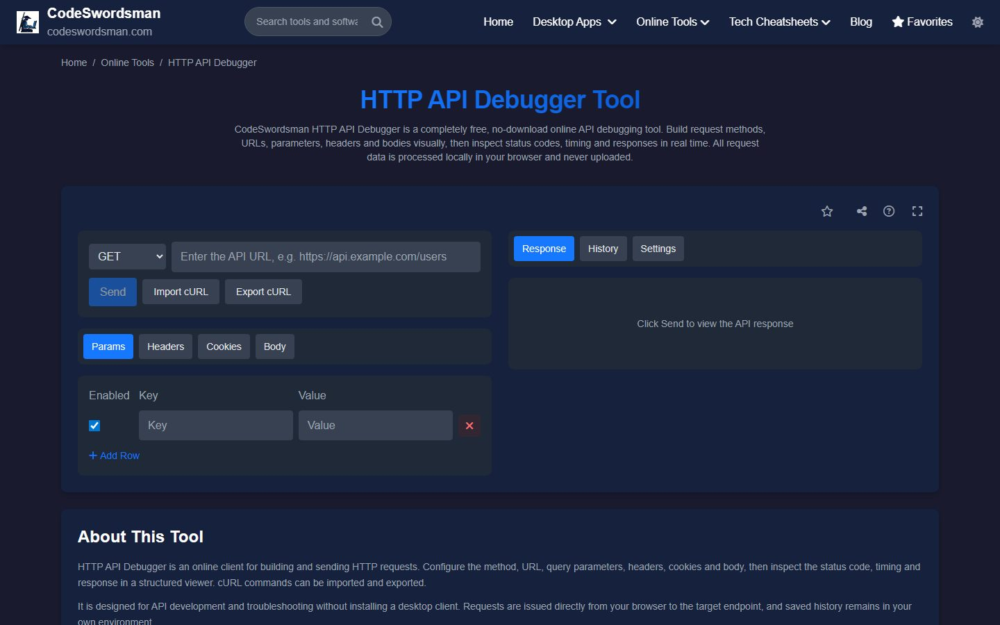

# Network & API Tools (12)

API debugging and network troubleshooting tools: an online HTTP request debugger, cURL to code conversion, WebSocket testing, DNS lookup, IP and MAC address generators, User-Agent parsing, cookie and header handling, and an HTTP status code reference. Useful for checking request headers, reproducing a browser call as a cURL command, or verifying a WebSocket endpoint.

<!-- AUTO:TOOLS_START -->
| Tool | What it does | Open |
| --- | --- | --- |
| HTTP API Debugger | CodeSwordsman HTTP API Debugger is a completely free | [Open](https://codeswordsman.com/en-US/tools/http-debugger) |
| WebSocket Tester | CodeSwordsman WebSocket Tester is a powerful online WebSocket debugger that supports… | [Open](https://codeswordsman.com/en-US/tools/websocket-tester) |
| cURL to Code Converter | Convert cURL commands into Python, JavaScript, Node.js, Go, PHP or Java request code | [Open](https://codeswordsman.com/en-US/tools/curl-converter) |
| URL Parser | Online URL parsing tool to analyze URL components | [Open](https://codeswordsman.com/en-US/tools/url-parser) |
| User-Agent Toolkit | Parse User-Agent strings into browser, engine, OS, device and CPU details | [Open](https://codeswordsman.com/en-US/tools/user-agent-toolkit) |
| Cookie Converter | Convert Cookie strings to JSON and back while preserving Path, Domain, Expires | [Open](https://codeswordsman.com/en-US/tools/cookie-converter) |
| HTTP Status & Port Reference | Searchable reference for HTTP status codes | [Open](https://codeswordsman.com/en-US/tools/http-reference) |
| IP Location Lookup | Look up IP or domain locations with IPv4/IPv6, country, region, city and ISP | [Open](https://codeswordsman.com/en-US/tools/ip-location-lookup) |
| IP Address Toolkit | Free online IP address toolkit with subnet mask calculation, CIDR calculation, subnetting | [Open](https://codeswordsman.com/en-US/tools/ip-address-toolkit) |
| IP Address Generator | Generate random IPv4 and IPv6 addresses in batch with optional prefixes and compressed… | [Open](https://codeswordsman.com/en-US/tools/ip-address-generator) |
| MAC Address Generator | Generate random MAC addresses with optional vendor OUI prefix | [Open](https://codeswordsman.com/en-US/tools/mac-address-generator) |
| HTTP Header & Auth Toolkit | Convert Request/Response header strings into JSON with duplicate keys merged into arrays | [Open](https://codeswordsman.com/en-US/tools/network-toolkit) |
<!-- AUTO:TOOLS_END -->

## Screenshot

## Related Categories

- [Encoding & Security Tools](security.md): JWT, hashing and encryption
- [Dev & Ops Tools](devops.md): Nginx, Docker and Kubernetes configs
- [Site & SEO Tools](site.md): redirects and site checks

Back to [all tools](../README.md)
