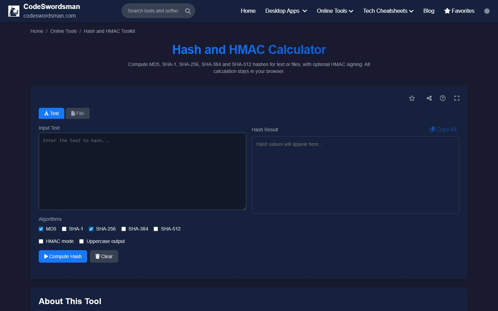

# Encoding & Security Tools (14)

Encoding and cryptography helpers: Base64 and URL encoding, MD5 and SHA hashing, AES and RSA encryption, JWT decoding and generation, Chinese SM2/SM3/SM4 algorithms, password strength checks and hash verification, security header generation and browser fingerprint inspection. Keys, plaintext and hashes are processed locally in your browser and are never sent to a backend.

<!-- AUTO:TOOLS_START -->
| Tool | What it does | Open |
| --- | --- | --- |
| URL/Base64 Converter | Online URL and Base64 conversion tool for convenient data transmission | [Open](https://codeswordsman.com/en-US/tools/url-base64-encoder) |
| Online Base64 Image Converter | Online Base64 Image Converter, supports bidirectional conversion between images and Base64 | [Open](https://codeswordsman.com/en-US/tools/base64-image-converter) |
| Base Converter | Convert between binary, decimal, hexadecimal and other different bases | [Open](https://codeswordsman.com/en-US/tools/base-converter) |
| MD5 Hash | Free online MD5 hash calculator supporting text and file MD5 computation with 16/32-bit… | [Open](https://codeswordsman.com/en-US/tools/md5-encryption) |
| Hash and HMAC Toolkit | Compute MD5, SHA-1, SHA-256, SHA-384 and SHA-512 hashes for text or files | [Open](https://codeswordsman.com/en-US/tools/hash-toolkit) |
| AES Encryption Tool | Encrypt and decrypt with AES, DES and 3DES in CBC, GCM, CTR and ECB modes | [Open](https://codeswordsman.com/en-US/tools/aes-encryption) |
| RSA Toolkit | Generate RSA key pairs, encrypt with the public key, decrypt and sign, with PEM import | [Open](https://codeswordsman.com/en-US/tools/rsa-toolkit) |
| SM Crypto | SM crypto online tool supporting SM2 asymmetric encryption/decryption with… | [Open](https://codeswordsman.com/en-US/tools/sm-crypto) |
| JWT Decoder | Decode JWT header and payload, inspect claims and expiry | [Open](https://codeswordsman.com/en-US/tools/jwt-decoder) |
| JWT Generator & Verifier | Sign JWTs locally in your browser with HS256/HS384/HS512, customize the header and payload | [Open](https://codeswordsman.com/en-US/tools/jwt-generator) |
| Password Strength Checker | Evaluate password strength, entropy and crack time locally | [Open](https://codeswordsman.com/en-US/tools/password-strength) |
| bcrypt & Argon2 Verifier | Generate bcrypt, Argon2id and scrypt password hashes locally in your browser | [Open](https://codeswordsman.com/en-US/tools/password-hash-verifier) |
| Security Headers Generator | Configure Content-Security-Policy and common security headers visually | [Open](https://codeswordsman.com/en-US/tools/security-headers-generator) |
| Browser Fingerprint Check | Collect Canvas, WebGL, AudioContext, fonts, timezone | [Open](https://codeswordsman.com/en-US/tools/browser-fingerprint) |
<!-- AUTO:TOOLS_END -->

## Screenshot

## Related Categories

- [Network & API Tools](network.md): HTTP debugging and request conversion
- [Site & SEO Tools](site.md): security headers and site checks
- [Text & Content Tools](text.md): encoding and text conversion

Back to [all tools](../README.md)
