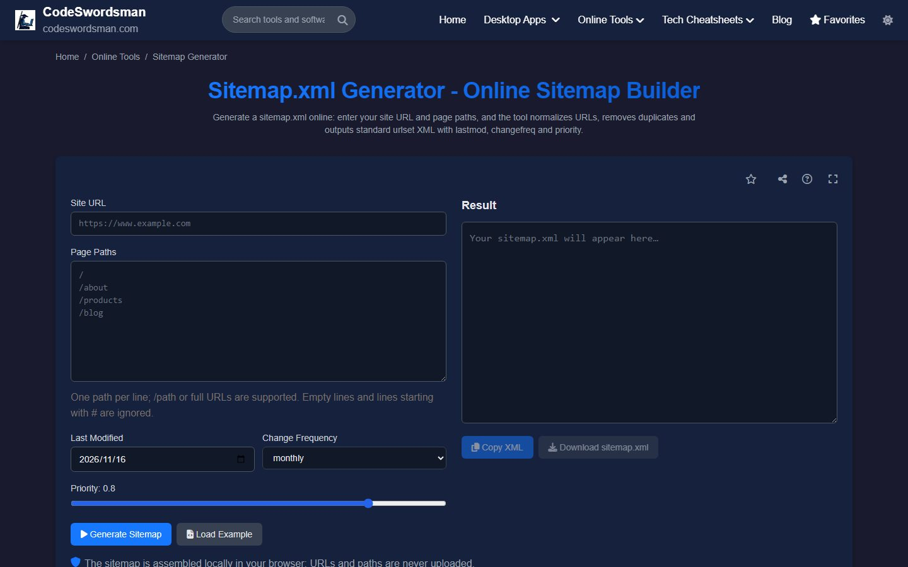

# Site & SEO Tools (19)

SEO and site operations tools: TDK checking, meta tag generation, sitemap generation and extraction, robots.txt generation, JSON-LD structured data, canonical and redirect chain checks, broken link checking, SSL certificate parsing, security header generation, social card previews, UTM link building, competitor matrices and marketing calendars. Handy for pre-launch checks and recurring SEO audits.

<!-- AUTO:TOOLS_START -->
| Tool | What it does | Open |
| --- | --- | --- |
| Meta Tag Generator | Fill in title, description | [Open](https://codeswordsman.com/en-US/tools/meta-tag-generator) |
| Robots.txt Generator | Generate robots.txt with User-agent, Allow, Disallow, Crawl-delay and Sitemap rules | [Open](https://codeswordsman.com/en-US/tools/robots-txt-generator) |
| Sitemap Generator | Generate sitemap.xml from a list of paths with lastmod, changefreq | [Open](https://codeswordsman.com/en-US/tools/sitemap-generator) |
| JSON-LD Structured Data Generator | Generate schema.org JSON-LD for articles, products, FAQs, breadcrumbs and more | [Open](https://codeswordsman.com/en-US/tools/json-ld-generator) |
| Web Assets Toolkit | Convert SVG to Data-URI | [Open](https://codeswordsman.com/en-US/tools/web-assets-toolkit) |
| TDK Checker | Fetch TDK, H1 and OG/Twitter metadata with missing and length checks | [Open](https://codeswordsman.com/en-US/tools/tdk-checker) |
| Sitemap & Link Extractor | Fetch sitemaps or extract page links, including indexes and gzip, copy or download | [Open](https://codeswordsman.com/en-US/tools/sitemap-extractor) |
| Broken Link Checker | Check up to 50 URLs at once with automatic GET fallback, grouped by healthy | [Open](https://codeswordsman.com/en-US/tools/broken-link-checker) |
| Redirect Chain Checker | Inspect short link redirects hop by hop with status codes and timings, detect loops | [Open](https://codeswordsman.com/en-US/tools/redirect-chain-checker) |
| HTTP Headers Checker | Check status code, redirect chain, gzip/brotli, HSTS and CDN details | [Open](https://codeswordsman.com/en-US/tools/http-headers-checker) |
| SSL Certificate Checker | Check a domain's SSL certificate in real time: issuer, validity | [Open](https://codeswordsman.com/en-US/tools/ssl-checker) |
| SSL Certificate Parser | Inspect subject, issuer, validity, SAN domains and SHA-256 fingerprint, including chains | [Open](https://codeswordsman.com/en-US/tools/ssl-cert-parser) |
| DNS Lookup | Query A, AAAA, CNAME, MX, TXT, NS and SOA records with values and TTLs | [Open](https://codeswordsman.com/en-US/tools/dns-lookup) |
| RDAP Domain Lookup | Look up registrar, registration and expiry dates, nameservers and status via RDAP | [Open](https://codeswordsman.com/en-US/tools/rdap-lookup) |
| Email Auth Checker | Check SPF, DMARC and DKIM records to review email sending security | [Open](https://codeswordsman.com/en-US/tools/email-auth-checker) |
| UTM Link Builder | Build campaign links with UTM parameters, channel presets, batch generation and QR codes | [Open](https://codeswordsman.com/en-US/tools/utm-link-builder) |
| Social Share Card Preview | Preview how a page looks on Twitter, WeChat, Feishu and LinkedIn, with title | [Open](https://codeswordsman.com/en-US/tools/social-card-preview) |
| Competitor Feature Matrix | Compare competitors feature by feature with weights, three-state ratings | [Open](https://codeswordsman.com/en-US/tools/competitor-matrix) |
| Marketing Calendar | Holidays, e-commerce sales and global events with countdowns and lead times | [Open](https://codeswordsman.com/en-US/tools/marketing-calendar) |
<!-- AUTO:TOOLS_END -->

## Screenshot

## Related Categories

- [Network & API Tools](network.md): HTTP debugging and DNS lookup
- [Encoding & Security Tools](security.md): security headers and certificates
- [Images & Visual Design Tools](visual.md): favicons and social images

Back to [all tools](../README.md)
