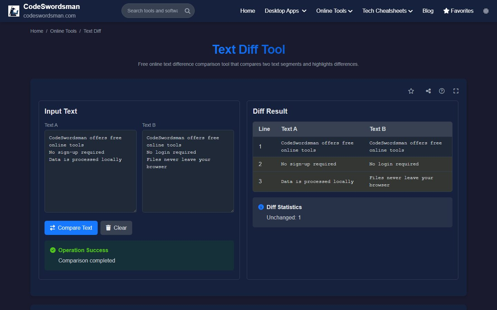
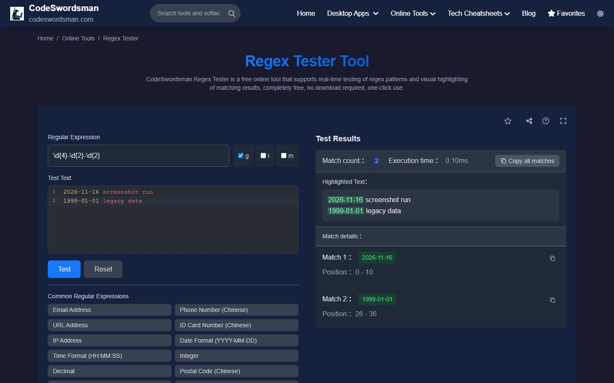

# Text & Content Tools (19)

Text handling tools for documentation, data cleanup and content checks: regex testing with live highlighting, text diff, character and word counting, case and full-width conversion, Unicode and text encoding conversion, Pinyin conversion, Markdown editing, AI prompt generation and text-to-speech. Everything runs in the browser, which makes them convenient for quick edits without uploading drafts anywhere.

<!-- AUTO:TOOLS_START -->
| Tool | What it does | Open |
| --- | --- | --- |
| Text Diff | Compare differences between two texts, highlighting different parts | [Open](https://codeswordsman.com/en-US/tools/text-diff) |
| Character Counter | CodeSwordsman Character Counter is an online tool that supports counting characters, words | [Open](https://codeswordsman.com/en-US/tools/character-counter) |
| Text Processor | A powerful online text processing tool that provides various text processing functions | [Open](https://codeswordsman.com/en-US/tools/text-processor) |
| Text Tools | A powerful online text tool that provides various text processing functions | [Open](https://codeswordsman.com/en-US/tools/text-tools) |
| HTML Entities Converter | Convert special characters to HTML entities to ensure normal webpage display | [Open](https://codeswordsman.com/en-US/tools/html-entities-converter) |
| Unicode Chinese Converter | Convert Chinese text to Unicode escapes and back | [Open](https://codeswordsman.com/en-US/tools/unicode-converter) |
| Full-width Converter | Convert between half-width and full-width characters, covering letters, digits | [Open](https://codeswordsman.com/en-US/tools/fullwidth-converter) |
| Chinese Converter | Convert between Simplified and Traditional Chinese | [Open](https://codeswordsman.com/en-US/tools/zh-converter) |
| Chinese to Pinyin | Convert Chinese text to pinyin with tone marks, without tones, or as initials | [Open](https://codeswordsman.com/en-US/tools/pinyin-converter) |
| HTML Text Encoding Toolkit | Convert HTML to a JavaScript string, strip HTML tags | [Open](https://codeswordsman.com/en-US/tools/text-encoding-toolkit) |
| HTML to Markdown Converter | Convert HTML to Markdown with headings, lists, tables, code blocks | [Open](https://codeswordsman.com/en-US/tools/html-to-markdown) |
| Variable Naming Converter | Convert between different naming conventions, such as camel case, snake case, etc | [Open](https://codeswordsman.com/en-US/tools/variable-naming-converter) |
| Regex Tester | Online regex testing tool to verify matching results | [Open](https://codeswordsman.com/en-US/tools/regex-tester) |
| Regex Code Generator | Test a regular expression with live match highlighting | [Open](https://codeswordsman.com/en-US/tools/regex-code-generator) |
| Morse Code & Fun Encoders | Encode and decode Morse code with audio playback, apply Caesar shifts | [Open](https://codeswordsman.com/en-US/tools/text-codec-fun) |
| Text to Speech | Read text aloud with the browser's built-in speech engine and adjust voice, rate | [Open](https://codeswordsman.com/en-US/tools/text-to-speech) |
| AI Prompt Generator | CodeSwordsman AI Prompt Generator is a powerful online tool designed for developers | [Open](https://codeswordsman.com/en-US/tools/ai-prompt-generator) |
| Token Counter | Count tokens with the encodings used by popular LLMs and estimate request cost from public… | [Open](https://codeswordsman.com/en-US/tools/token-counter) |
| PRD & User Story Generator | Generate structured PRDs with feature lists and Given-When-Then acceptance criteria | [Open](https://codeswordsman.com/en-US/tools/prd-generator) |
<!-- AUTO:TOOLS_END -->

## Screenshots

## Related Categories

- [Code & Formatting Tools](code.md): formatting, minifying and obfuscation
- [Files & Documents Tools](file.md): Excel, PDF and Markdown export
- [Encoding & Security Tools](security.md): Base64, hashing and encryption

Back to [all tools](../README.md)
