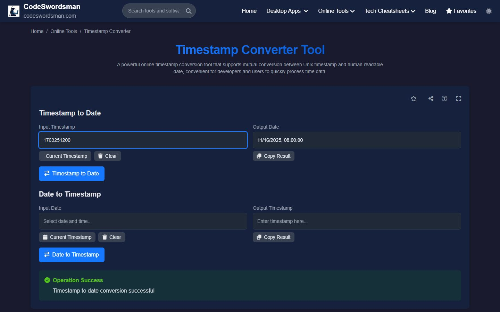
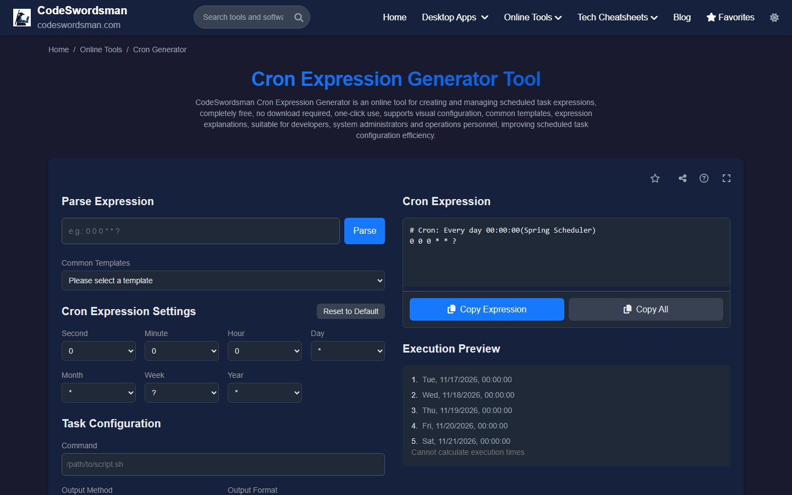

# Time & Conversion Tools (5)

Time and unit conversion tools: Unix timestamp to date and back, cron expression generation and parsing, timezone conversion and world clock, date calculation, and unit conversion for length, weight, area, temperature and storage. Useful for reading log timestamps, writing scheduled jobs, or aligning times across timezones.

<!-- AUTO:TOOLS_START -->
| Tool | What it does | Open |
| --- | --- | --- |
| Timestamp Converter | Convert between Unix timestamp and human-readable time | [Open](https://codeswordsman.com/en-US/tools/timestamp-converter) |
| Timezone Converter | Compare times across cities | [Open](https://codeswordsman.com/en-US/tools/timezone-converter) |
| Date Calculator | Day and workday differences, date arithmetic, age and next birthday — computed locally | [Open](https://codeswordsman.com/en-US/tools/date-calculator) |
| Cron Generator | Online Cron expression generation tool for scheduled task configuration | [Open](https://codeswordsman.com/en-US/tools/cron-generator) |
| Unit Converter | Convert length, weight, temperature, area, volume, time, speed, storage | [Open](https://codeswordsman.com/en-US/tools/unit-converter) |
<!-- AUTO:TOOLS_END -->

## Screenshots

## Related Categories

- [Dev & Ops Tools](devops.md): systemd units and scheduled tasks
- [JSON & Data Format Tools](data.md): timestamp fields in data
- [Text & Content Tools](text.md): log text processing

Back to [all tools](../README.md)
