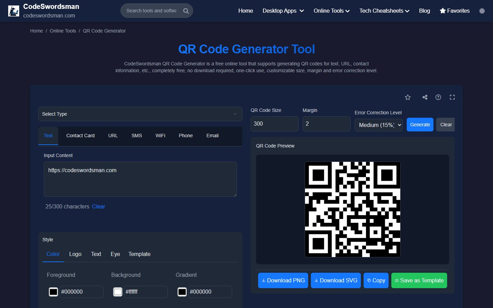
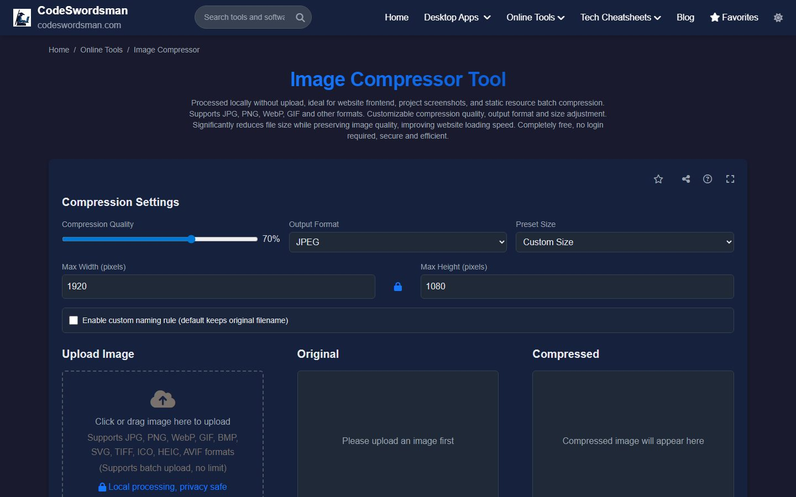

# Images & Visual Design Tools (22)

Image processing and design helpers: image compression, format conversion, cropping and resizing, batch watermarks, image to Base64, QR code generation and reading, barcode generation, color picking and format conversion, CSS visual effect and clip-path generators, favicon generation, font conversion, SVG optimization and image OCR. Files are handled in the browser, so screenshots and design assets stay on your machine.

<!-- AUTO:TOOLS_START -->
| Tool | What it does | Open |
| --- | --- | --- |
| Image Compressor | ideal for website frontend, project screenshots, static resource batch compression | [Open](https://codeswordsman.com/en-US/tools/image-compressor) |
| Image Format Converter | Batch convert PNG, JPEG, WebP, AVIF and ICO with HEIC input | [Open](https://codeswordsman.com/en-US/tools/image-format-converter) |
| Image Cropper | Drag to crop, lock aspect ratios, rotate and flip | [Open](https://codeswordsman.com/en-US/tools/image-cropper) |
| Image Watermark | Add text watermarks with custom size, color, opacity, rotation and tiling | [Open](https://codeswordsman.com/en-US/tools/image-watermark) |
| Image Splitter & Stitcher | Split an image into a 3×3 grid or custom rows and columns | [Open](https://codeswordsman.com/en-US/tools/image-splitter) |
| Image OCR | Extract text from images locally in your browser, with Chinese | [Open](https://codeswordsman.com/en-US/tools/image-ocr) |
| EXIF Viewer & Remover | Inspect camera, lens, capture time and GPS data | [Open](https://codeswordsman.com/en-US/tools/exif-viewer) |
| Image Metadata Remover | Remove EXIF, GPS location and text comments from JPEG | [Open](https://codeswordsman.com/en-US/tools/exif-remover) |
| QR Code Generator | Convert text or URL to QR code for easy scanning access | [Open](https://codeswordsman.com/en-US/tools/qrcode-generator) |
| Bulk QR Generator | Paste one item per line to generate up to 50 QR codes at once and download them as a ZIP | [Open](https://codeswordsman.com/en-US/tools/qrcode-styler) |
| QR Code Reader | Online QR code recognition tool to extract QR code information from images | [Open](https://codeswordsman.com/en-US/tools/qrcode-reader) |
| Barcode Generator | Generate CODE128, CODE39, EAN-13 and UPC barcodes, export PNG or SVG | [Open](https://codeswordsman.com/en-US/tools/barcode-generator) |
| Font Converter | Convert TTF, OTF, WOFF and WOFF2 online, subset fonts to keep chosen characters | [Open](https://codeswordsman.com/en-US/tools/font-converter) |
| Favicon Generator | Upload one image to generate favicons from 16 to 512 px, a multi-size favicon.ico | [Open](https://codeswordsman.com/en-US/tools/favicon-generator) |
| Social Image Resizer | Upload one key visual and export every social size at once with crop or fit modes | [Open](https://codeswordsman.com/en-US/tools/social-image-resizer) |
| Word Cloud Generator | Turn reviews or survey text into a word cloud with adjustable shape, palette and rotation | [Open](https://codeswordsman.com/en-US/tools/word-cloud-generator) |
| CSS Visual Generator | Visually build CSS gradients, shadows | [Open](https://codeswordsman.com/en-US/tools/css-visual-generator) |
| Flex/Grid Layout Generator | Tune Flex and Grid properties visually | [Open](https://codeswordsman.com/en-US/tools/css-layout-generator) |
| clip-path Shape Generator | Generate CSS clip-path shapes online | [Open](https://codeswordsman.com/en-US/tools/clip-path-generator) |
| CSS Unit Converter | Convert between px, rem, em, percent, vw | [Open](https://codeswordsman.com/en-US/tools/css-unit-converter) |
| Color Converter | Convert between different color formats, such as RGB, HEX, HSL, etc | [Open](https://codeswordsman.com/en-US/tools/color-converter) |
| Mermaid Diagram Editor | Draw flowcharts, sequence and ER diagrams, Gantt charts with plain text | [Open](https://codeswordsman.com/en-US/tools/mermaid-renderer) |
<!-- AUTO:TOOLS_END -->

## Screenshots

## Related Categories

- [Files & Documents Tools](file.md): Excel, PDF and ZIP handling
- [Site & SEO Tools](site.md): favicons, social cards and TDK
- [Text & Content Tools](text.md): text conversion and processing

Back to [all tools](../README.md)
